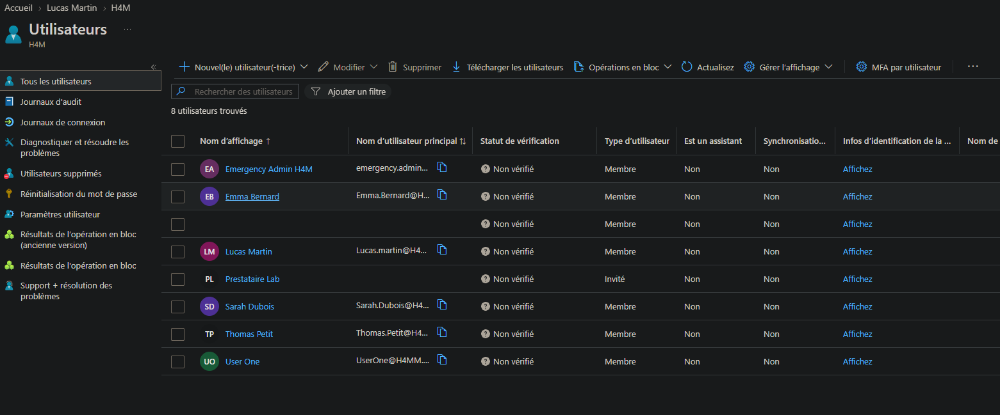
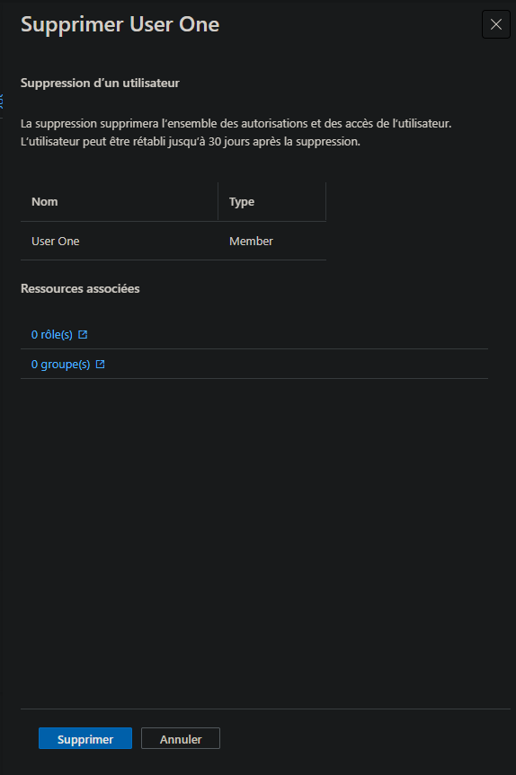
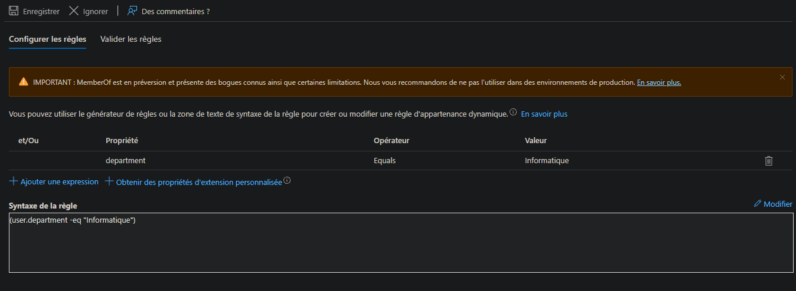
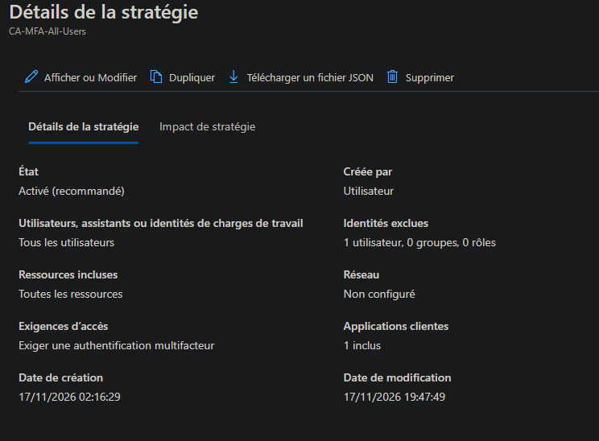
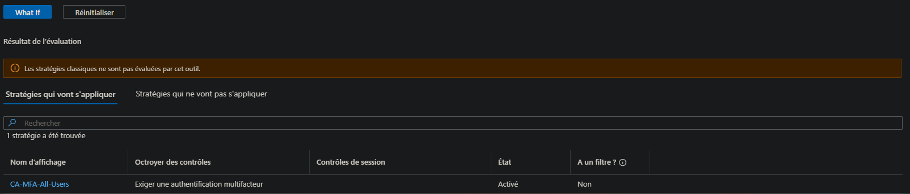
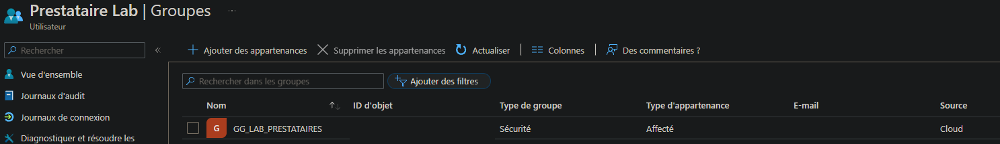
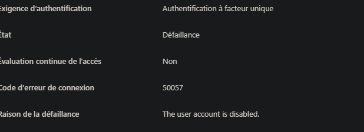

# Module 01 · Microsoft Entra ID

**État · Exercices pratiques terminés.**

J’ai commencé mon lab Azure par les identités. Je voulais savoir créer des comptes, régler leurs accès et comprendre ce que le journal me raconte quand une connexion réussit ou échoue. J’ai fait les essais dans le centre d’administration Microsoft Entra. Les noms de test qui apparaissent dans les captures sont fictifs. J’ai masqué les données personnelles réelles.

## 1. Utilisateurs · Je commence par créer un compte

Dans le centre d’administration Microsoft Entra, j’ai créé le compte membre Lucas Martin. J’ai vérifié qu’il apparaissait dans l’annuaire. Plus tard, pendant le test du groupe dynamique, j’ai modifié son attribut `department` pour voir l’effet sur son appartenance au groupe.

J’ai aussi ouvert le dialogue de suppression du compte fictif User One. La capture s’arrête à la confirmation. Il me reste à documenter le résultat final dans **Utilisateurs supprimés**. J’ai testé la désactivation d’un compte séparément, pendant le [diagnostic de connexion](#8-dépannage--je-remonte-de-lerreur-à-la-cause). Sa fiche affichait **Désactivé**.



*Liste des utilisateurs du tenant avec les noms et UPN fictifs du lab.*


*État Désactivé sur la fiche d’un compte de test.*



*Dialogue de confirmation de suppression du compte fictif User One.*

## 2. Groupes · Je laisse Entra ID calculer les membres

Je voulais voir comment l’appartenance change quand je passe d’un groupe attribué à un groupe dynamique. J’ai créé deux groupes de sécurité. Pour `DG-IT-Users`, j’ai choisi **Utilisateur dynamique** et j’ai défini cette règle.

```text
(user.department -eq "Informatique")
```

J’ai changé le service de Lucas Martin, puis je l’ai remis à sa valeur initiale. J’ai relevé son retrait puis sa réintégration. L’appartenance suivait la valeur de `department`. Mes captures montrent le type de groupe et la règle. Il me reste à joindre les listes de membres avant et après le changement.

Pour `GG_LAB_PRESTATAIRES`, j’ai choisi une appartenance attribuée. J’ai testé l’ajout et le retrait d’un membre avec le compte invité de l’exercice B2B.


*Groupe DG-IT-Users de type Sécurité avec appartenance Utilisateur dynamique.*



*Règle d’appartenance basée sur l’attribut department.*

## 3. Permissions · Je délègue une tâche de support

Je voulais déléguer la réinitialisation d’un mot de passe. J’ai attribué directement le rôle intégré **Administrateur de mots de passe** à Lucas Martin. Dans **Rôles affectés**, j’ai vérifié l’attribution et sa portée : le répertoire, au niveau de l’organisation.

J’ai ensuite relevé une réinitialisation réussie pour le compte de test Emma Bernard. Ce résultat montre ce que l’attribution a permis pour cette tâche. Il me reste à joindre la preuve du résultat et, si je retrouve la trace d’un essai hors du périmètre du rôle, son résultat.


*Attribution directe du rôle intégré au niveau du répertoire.*

## 4. MFA · Je vérifie ce que le journal a enregistré

Pour mes essais d’authentification, j’ai utilisé le mot de passe et Microsoft Authenticator. Avec la stratégie MFA de l’exercice suivant, j’ai regardé dans les détails d’authentification si l’exigence était satisfaite.

J’y ai lu `Previously satisfied` pour le MFA. Le journal m’indiquait que l’exigence avait déjà été remplie. Il me reste à joindre la capture d’enregistrement de la méthode et, si je dispose d’une trace, celle d’une nouvelle demande MFA.


*Détails d’authentification montrant deux exigences déjà satisfaites.*

## 5. Accès conditionnel · Je simule, puis je lis le journal réel

J’ai configuré `CA-MFA-All-Users` pour voir dans quel cas Entra ID demanderait le MFA. Voici les réglages que j’ai relevés dans le portail.

| Paramètre | Valeur affichée |
| --- | --- |
| État | Activée |
| Utilisateurs et ressources | Tous les utilisateurs et toutes les ressources |
| Exclusions | Un utilisateur, aucun groupe ni rôle |
| Réseau | Aucun réseau configuré |
| Applications clientes | Une catégorie incluse |
| Contrôle d’octroi | Exiger le MFA |

Il me reste à préciser la catégorie d’applications clientes et la fonction du compte exclu. J’ai aussi relevé que `CA-MFA-Admins` et `CA-Block-Legacy-Auth` étaient activées. Je dois encore documenter leurs paramètres.

J’ai lancé **What If**. Dans cette simulation, seule `CA-MFA-All-Users` était applicable et le contrôle affiché exigeait le MFA. Je dois encore joindre les paramètres d’entrée du scénario.

Dans le journal de ma connexion réelle, j’ai relevé **Conditional Access** dans les détails d’authentification. Il me reste à joindre la vue des stratégies évaluées pour déterminer quelle stratégie nommée s’est appliquée.

J’avais relevé Microsoft Entra ID Free au démarrage. Je dois encore confirmer la licence ou l’essai utilisé au moment d’activer l’accès conditionnel et les groupes dynamiques.


*Liste des trois stratégies affichées comme activées.*



*Paramètres visibles de CA-MFA-All-Users dans le portail.*



*Résultat de What If indiquant une seule stratégie applicable et le contrôle MFA.*

## 6. Invités B2B · Je retire un invité du groupe

J’ai invité **Prestataire Lab** et j’ai vérifié que l’invitation était **Acceptée**. J’ai ensuite ajouté le compte au groupe de sécurité attribué `GG_LAB_PRESTATAIRES`. Dans l’onglet **Groupes**, j’ai vu le groupe apparaître.

Après avoir retiré l’invité du groupe, j’ai rouvert sa fiche. Il n’avait plus de groupe et son compte était toujours présent dans l’annuaire. J’ai ainsi vérifié l’appartenance au groupe. Je n’ai pas testé l’accès à une application via ce groupe.


*Statut Accepté de l’invitation B2B.*



*Prestataire Lab présent dans le groupe de sécurité attribué.*


*Fiche de l’invité toujours disponible après retrait de son groupe.*

## 7. Journaux Entra ID · Je relis ma connexion à My Apps

Je me suis connecté à **My Apps** depuis mon navigateur. La connexion a réussi, alors j’ai ouvert le journal Entra pour voir comment elle avait été authentifiée. J’ai retrouvé **My Apps** et le type de client **Browser**, puis j’ai ouvert les détails d’authentification.

Les deux lignes affichaient `Previously satisfied`. Le premier facteur et le MFA avaient donc déjà été validés. C’est ce qui explique pourquoi je n’ai pas reçu de nouvelle demande MFA. Il me reste à joindre la capture de l’état global **Réussite**.


*Détails de l’événement My Apps avec le client Browser.*


*Premier facteur et exigence MFA indiqués comme déjà satisfaits.*

## 8. Dépannage · Je remonte de l’erreur à la cause

Pour reproduire un refus de connexion, j’ai désactivé un compte de test et j’ai essayé de me connecter à **My Apps**. Dans le journal de connexion, j’ai relevé le code `50057` et le motif `The user account is disabled.`

J’ai ouvert le journal d’audit pour retrouver l’action de désactivation. J’avais ainsi le refus côté connexion et la modification du compte côté audit. J’ai réactivé le compte, puis j’ai refait le test. Cette fois, la connexion a réussi. Il me reste à joindre la ligne d’audit et l’événement de réussite après réactivation.



*Événement de connexion en échec avec le code 50057 et le compte désactivé comme motif.*

[Accueil du portfolio](../README.md) · [Module suivant · Gouvernance Azure et RBAC](../02-Azure-Governance-RBAC/README.md)
