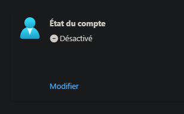
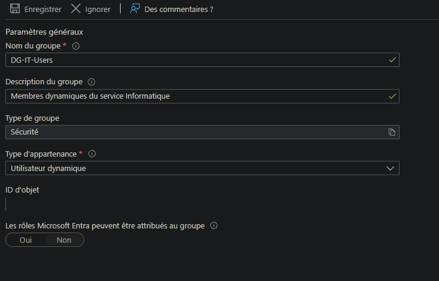
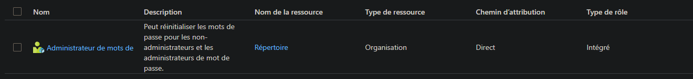
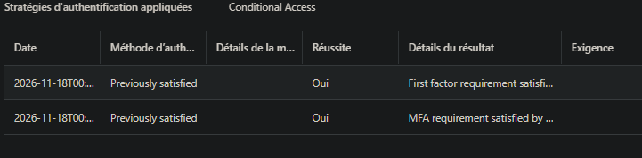
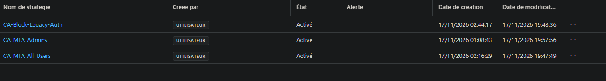
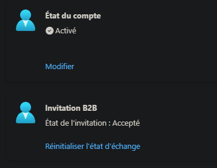
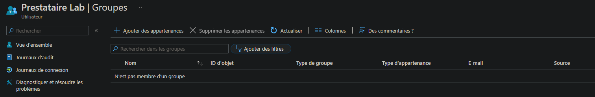
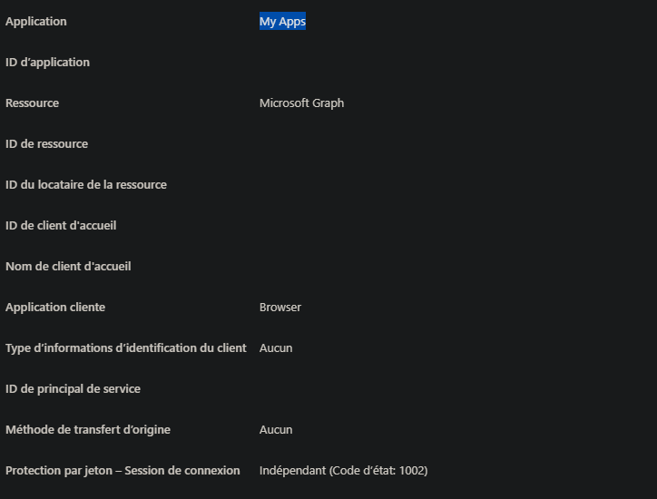

# Module 01 · Microsoft Entra ID

**État · Exercices pratiques terminés.** Les résultats ci-dessous distinguent les observations du portail, les confirmations issues des échanges et les preuves encore à joindre.

Les exercices ont été réalisés dans le centre d’administration Microsoft Entra. Les actions décrites s’appuient sur les échanges retrouvés et sur les captures du lab. Les comptes internes sont désignés par leur fonction ou par un alias. Les captures publiées ont été recadrées ou masquées selon leur contenu.

## 1. Utilisateurs · Gérer le cycle de vie d’un compte

- **Objectif** · Créer, modifier, désactiver et supprimer une identité de test.
- **Actions effectuées** · Création d’un compte membre, puis modification de l’attribut `department` d’un utilisateur de test pendant le contrôle du groupe dynamique. Un compte de test a été désactivé pendant l’exercice 8. Le dialogue de suppression d’un autre compte de test a été ouvert.
- **Vérification et résultat** · La création a été vérifiée dans l’annuaire. L’état **Désactivé** est visible sur la fiche du compte concerné. Le dialogue de suppression montre l’opération proposée. La confirmation finale et la présence dans **Utilisateurs supprimés** restent à documenter.


*Liste des utilisateurs du tenant, noms et UPN masqués.*



*État Désactivé sur la fiche d’un compte de test.*


*Dialogue de confirmation de suppression du compte fictif User One.*

## 2. Groupes · Gérer l’appartenance attribuée et dynamique

- **Objectif** · Comparer l’ajout explicite à un groupe de sécurité et l’évaluation automatique selon un attribut.
- **Actions effectuées** · Création du groupe de sécurité `GG_LAB_PRESTATAIRES` à appartenance attribuée et du groupe de sécurité `DG-IT-Users` à appartenance **Utilisateur dynamique**. Configuration de la règle suivante.

```text
(user.department -eq "Informatique")
```

- **Vérification et résultat** · L’ajout et le retrait d’un membre du groupe attribué sont visibles à l’exercice 6. Le suivi de l’exercice dynamique rapporte le retrait puis la réintégration d’un compte de test après modification de son service. Les captures montrent le type du groupe et la règle. Les listes de membres avant et après le changement d’attribut restent à joindre.



*Groupe DG-IT-Users de type Sécurité avec appartenance Utilisateur dynamique.*


*Règle d’appartenance basée sur l’attribut department.*

## 3. Permissions · Déléguer une réinitialisation de mot de passe

- **Objectif** · Déléguer une tâche de support avec un rôle Microsoft Entra adapté.
- **Actions effectuées** · Attribution directe du rôle intégré **Administrateur de mots de passe** à un compte de test. La portée affichée est le répertoire, au niveau de l’organisation.
- **Vérification et résultat** · Le rôle apparaît dans **Rôles affectés**. Le suivi de l’exercice rapporte une réinitialisation réussie sur un autre compte de test. Une preuve du résultat de la réinitialisation et un éventuel test de refus hors du périmètre du rôle restent à joindre.



*Attribution directe du rôle intégré au niveau du répertoire.*

## 4. MFA · Configurer et vérifier l’authentification multifacteur

- **Objectif** · Vérifier qu’une exigence MFA est satisfaite pour une connexion de test.
- **Actions effectuées** · Le suivi du lab mentionne le mot de passe et Microsoft Authenticator parmi les méthodes utilisées. La stratégie décrite à l’exercice 5 exige le MFA. Le test de connexion a été contrôlé dans les détails d’authentification.
- **Vérification et résultat** · Le journal montre que l’exigence MFA était déjà satisfaite (`Previously satisfied`). Une capture d’enregistrement de la méthode et une preuve de nouveau défi MFA lors de la connexion restent à joindre pour documenter ces étapes.



*Détails d’authentification montrant deux exigences déjà satisfaites.*

## 5. Accès conditionnel · Contrôler l’application d’une stratégie

- **Objectif** · Déterminer si une stratégie impose le MFA dans un scénario de test.
- **Actions effectuées** · Configuration de `CA-MFA-All-Users`. La stratégie est affichée **Activée** avec **Tous les utilisateurs**, **Toutes les ressources**, un utilisateur exclu, aucun groupe ni rôle exclu, aucun réseau configuré et une catégorie d’applications clientes incluse. Le contrôle d’octroi exige le MFA. Le détail de la catégorie d’applications clientes et la fonction du compte exclu restent à confirmer. Les stratégies `CA-MFA-Admins` et `CA-Block-Legacy-Auth` apparaissent également **Activées**. Leurs paramètres détaillés restent à documenter.
- **Vérification et résultat** · **What If** a renvoyé `CA-MFA-All-Users` comme seule stratégie applicable dans le scénario affiché, avec exigence MFA. Les paramètres d’entrée de la simulation restent à joindre. Le journal réel indique **Conditional Access** dans les détails d’authentification. L’écran détaillant les stratégies évaluées sur cette connexion reste à joindre pour relier ce résultat à une stratégie nommée.
- **Licence** · Microsoft Entra ID Free a été indiqué au démarrage du lab. La licence ou l’essai effectivement utilisé lors de l’activation de l’accès conditionnel et des groupes dynamiques reste à confirmer.



*Liste des trois stratégies affichées comme activées.*


*Paramètres visibles de CA-MFA-All-Users dans le portail.*


*Résultat de What If indiquant une seule stratégie applicable et le contrôle MFA.*

## 6. Identités externes B2B · Gérer l’appartenance d’un invité

- **Objectif** · Vérifier l’ajout et le retrait d’un invité dans un groupe de sécurité tout en conservant son identité dans l’annuaire.
- **Actions effectuées** · Invitation de **Prestataire Lab**, puis ajout au groupe `GG_LAB_PRESTATAIRES` et retrait.
- **Vérification et résultat** · Invitation **Acceptée**. L’onglet **Groupes** affichait le groupe après l’ajout, puis aucun groupe après le retrait. La fiche de l’invité restait présente. Le test couvrait l’appartenance au groupe. L’accès à une application via ce groupe n’a pas été testé.



*Statut Accepté de l’invitation B2B.*


*Prestataire Lab présent dans le groupe de sécurité attribué.*



*Fiche de l’invité toujours disponible après retrait de son groupe.*

## 7. Journaux de connexion · Interpréter les détails de My Apps

- **Objectif** · Identifier l’application, le type de client et les exigences d’authentification dans un événement de connexion.
- **Actions effectuées** · Connexion à **My Apps** dans un navigateur, puis consultation de l’événement et de ses détails d’authentification.
- **Vérification et résultat** · Connexion réussie selon le résultat relevé. La capture de l’événement identifie **My Apps** et **Browser**. Le premier facteur et le MFA étaient déjà satisfaits (`Previously satisfied`). Le journal indique des exigences déjà remplies lors de cette connexion. La capture de l’état global **Réussite** reste à joindre.



*Détails de l’événement My Apps avec le client Browser.*


*Premier facteur et exigence MFA indiqués comme déjà satisfaits.*

## 8. Dépannage · Diagnostiquer une connexion refusée

- **Objectif** · Corréler une erreur de connexion avec une modification du compte et vérifier le retour au service.
- **Actions effectuées** · Désactivation d’un compte de test et tentative de connexion à **My Apps**. Consultation du journal de connexion, puis du journal d’audit pour retrouver l’action de désactivation. Réactivation du compte et nouvel essai.
- **Vérification et résultat** · Le journal de connexion a affiché le code `50057` et le motif `The user account is disabled.` La désactivation a été retrouvée dans le journal d’audit et la connexion après réactivation a réussi, selon le compte rendu du test. La ligne d’audit et le nouvel événement de réussite restent à joindre.


*Événement de connexion en échec avec le code 50057 et le compte désactivé comme motif.*

[Accueil du portfolio](../README.md) · [Module suivant · Gouvernance Azure et RBAC](../02-Azure-Governance-RBAC/README.md)
