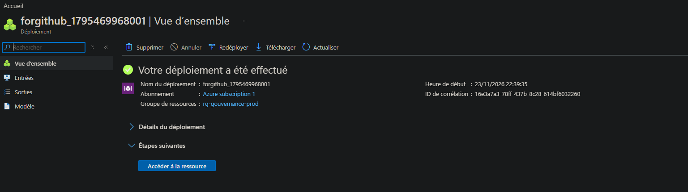
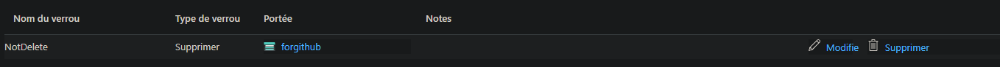
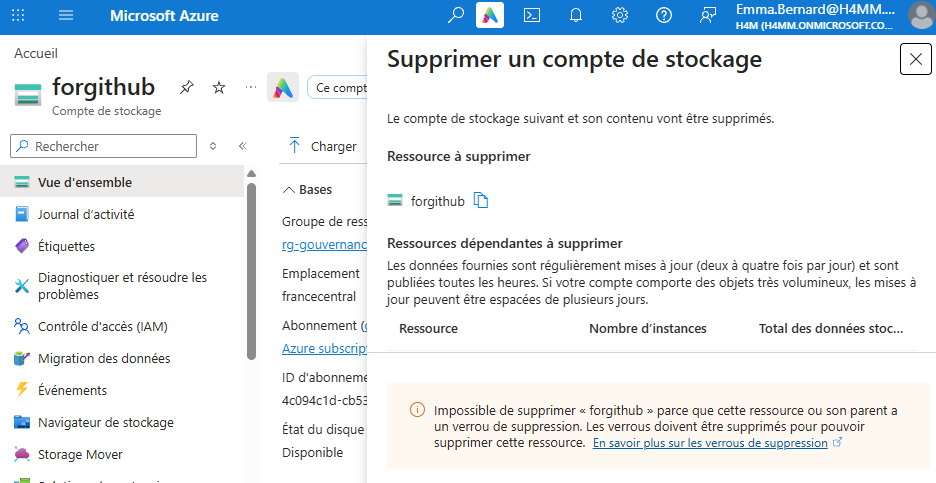
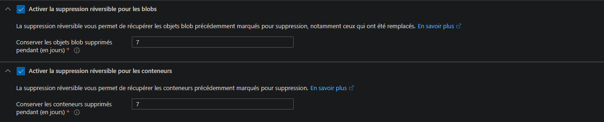
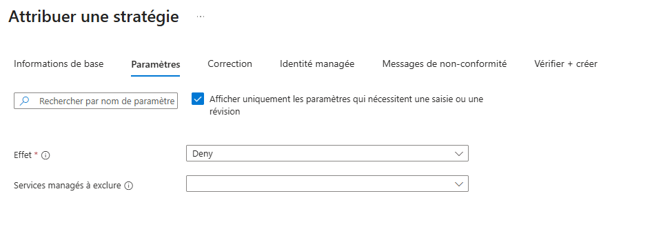
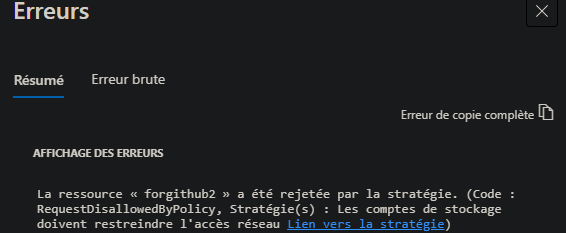
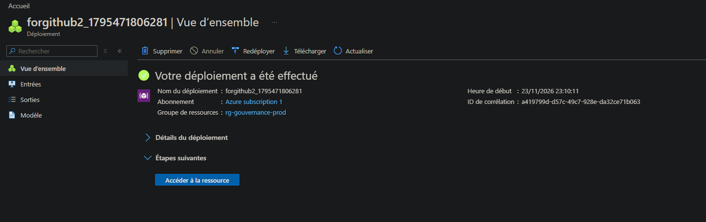
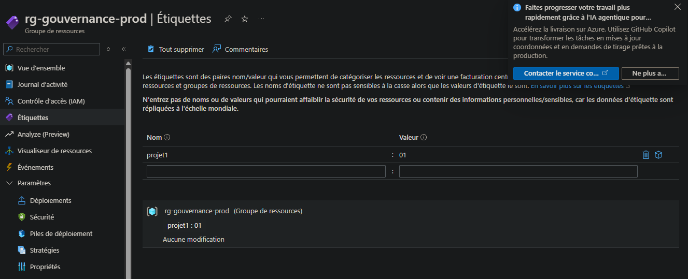
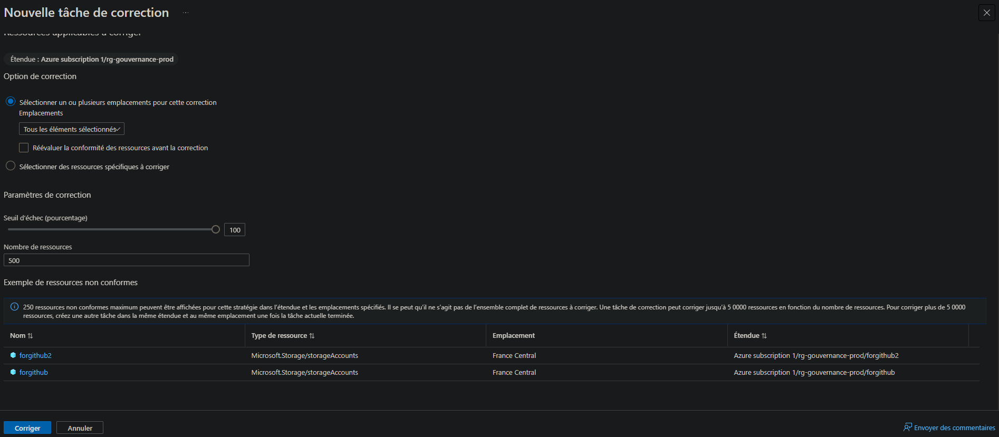

# Gouvernance Azure et RBAC

**État du module** · Tests pratiques documentés

J’ai pris un compte de stockage comme point de départ. Je voulais comprendre comment les droits, les verrous et Azure Policy se complètent. J’ai fait ces manipulations dans le portail Azure, dans le groupe de ressources `rg-gouvernance-prod`.

## 1. Je donne à Emma accès aux blobs

J’ai créé le compte de stockage `forgithub`. J’ai ensuite ajouté `Emma.Bernard` à un groupe disposant des rôles **Lecteur** et **Lecteur des données blob du stockage**. Emma reçoit ces droits par son groupe.

| Rôle | Ce qu’Emma peut lire |
| --- | --- |
| Lecteur | Elle peut consulter les ressources Azure et leur configuration dans la portée attribuée. |
| Lecteur des données blob du stockage | Elle peut lire les conteneurs et les données blob dans la portée attribuée. |

Je voulais distinguer la consultation du compte de stockage de la lecture des données qu’il contient. J’ai attribué les deux rôles au groupe pour couvrir ces deux besoins. Je n’ai pas encore joint de capture des attributions du groupe ni du résultat de lecture d’un blob avec Emma.

*Le déploiement de forgithub a réussi dans rg-gouvernance-prod.*

## 2. Je teste le verrou, puis la suppression réversible

J’ai posé un verrou nommé `NotDelete`, de niveau `CanNotDelete`, sur `forgithub`. Je voulais empêcher la suppression du compte de stockage. Depuis la session d’Emma, j’ai tenté de supprimer ce compte.

*Le verrou NotDelete apparaît à la portée de forgithub.*

Le portail a affiché ce motif.

> Impossible de supprimer « forgithub » parce que cette ressource ou son parent a un verrou de suppression.

La capture confirme que le portail a signalé le verrou. Emma disposait déjà de rôles de lecture. Le refus, pris seul, ne permet donc pas de savoir ce qui se serait passé avec un compte autorisé à supprimer la ressource en l’absence de verrou. Pour ce test, je retiens le motif précis affiché et les droits dont disposait Emma.

*Dans la session d’Emma, le portail indique qu’un verrou de suppression bloque l’opération.*

J’ai aussi activé et testé la suppression réversible des blobs. La capture des paramètres montre une conservation de **7 jours** pour les blobs et les conteneurs. Je voulais examiner la protection des données contenues dans le compte. Supprimer le compte de stockage et supprimer un blob sont deux opérations distinctes. Le verrou porte ici sur la ressource Azure. La suppression réversible concerne les données supprimées.

J’ai effectué le test de suppression réversible. Je dois encore joindre la preuve du résultat sur le blob et, pour documenter une récupération, la capture qui la confirme.

*La suppression réversible des blobs et des conteneurs est activée avec une conservation de 7 jours.*

## 3. Ma première stratégie réseau laisse passer la création

J’ai configuré la stratégie Azure Policy **Les comptes de stockage doivent restreindre l’accès réseau**. Je l’ai utilisée pour contrôler les paramètres réseau des comptes de stockage.

Pour la tester, j’ai tenté de créer `forgithub2` avec des paramètres réseau trop ouverts. Je m’attendais à un blocage. Pourtant, la création a été autorisée.

En regardant l’effet de la stratégie, j’ai compris pourquoi. J’avais choisi `Audit`. Avec cet effet, Azure Policy signale l’écart de conformité et laisse passer la demande. Mon attente de blocage ne correspondait donc pas à l’effet configuré.

J’ai changé l’effet en `Deny`, puis j’ai refait un test avec des paramètres non conformes. Cette fois, Azure a refusé la création. La capture affiche le code `RequestDisallowedByPolicy` et désigne la stratégie réseau.

*Le paramètre Effet est réglé sur Deny.*

*Le portail rejette forgithub2 avec le code RequestDisallowedByPolicy.*

J’ai ensuite ajusté les paramètres réseau. Le test avec une configuration conforme a réussi. À la fin des essais, `forgithub` et `forgithub2` figuraient dans `rg-gouvernance-prod`. Je garde ici les résultats de ces essais successifs, sans reconstruire les opérations intermédiaires qui ne sont pas documentées.

| Test | Effet | Résultat observé |
| --- | --- | --- |
| Paramètres réseau trop ouverts | `Audit` | Création autorisée et écart signalé |
| Paramètres non conformes | `Deny` | Création refusée par Azure Policy |
| Paramètres ajustés et conformes | `Deny` | Test réussi et déploiement effectué |

*Le déploiement de forgithub2 a réussi dans rg-gouvernance-prod.*

## 4. Je traite le compte déjà en place

Après l’application de la stratégie réseau, mon compte initial `forgithub` est apparu comme non conforme. J’ai créé une exemption pour ce compte.

L’exemption permet de suivre cette ressource comme une exception à l’attribution de stratégie concernée. Elle ne rend pas ses paramètres réseau conformes et ne les modifie pas. Dans mon suivi, je dois donc distinguer une ressource exemptée d’une ressource dont la configuration respecte la règle.

*L’attribution de stratégie réseau affiche un état Non conforme.*

## 5. Je propage la balise aux ressources existantes

J’ai ajouté la balise suivante sur `rg-gouvernance-prod`.

| Clé | Valeur |
| --- | --- |
| `projet1` | `01` |

*Le groupe rg-gouvernance-prod porte la balise projet1 de valeur 01.*

Je voulais retrouver cette balise sur les deux comptes de stockage déjà créés. Une balise posée sur le groupe de ressources ne se copie pas automatiquement sur ses ressources. J’ai donc configuré la stratégie **Hériter d’une étiquette du groupe de ressources si elle est manquante**, avec `projet1` comme nom de balise.

Le récapitulatif de l’attribution indiquait une identité managée affectée par le système et aucune tâche de correction créée à cette étape. J’ai ensuite lancé une tâche de correction pour appliquer la balise aux ressources existantes. Le formulaire listait `forgithub` et `forgithub2`.

Une capture montre `projet1` avec la valeur `01` sur `forgithub2`. Je n’ai pas de capture équivalente pour `forgithub`. Pour les deux comptes ensemble, j’arrête donc le récit au lancement de la correction.

*Le formulaire de correction liste forgithub et forgithub2 parmi les ressources à corriger.*

## Ce que je retiens pour administrer un environnement Azure

Je commencerai par regarder les droits du compte qui effectue un test. Un refus de suppression se comprend avec les rôles attribués et le message exact du portail.

Je vérifierai aussi l’effet d’une stratégie avant de conclure qu’elle ne fonctionne pas. Mon premier essai m’a montré concrètement pourquoi `Audit` laisse passer une création et pourquoi `Deny` peut la refuser.

Enfin, je suivrai les exceptions et les corrections séparément. Une exemption documente une exception. Une tâche de correction applique un changement aux ressources existantes. Pour confirmer son résultat, je vérifierai chaque ressource visée.

[Accueil du portfolio](../README.md)
