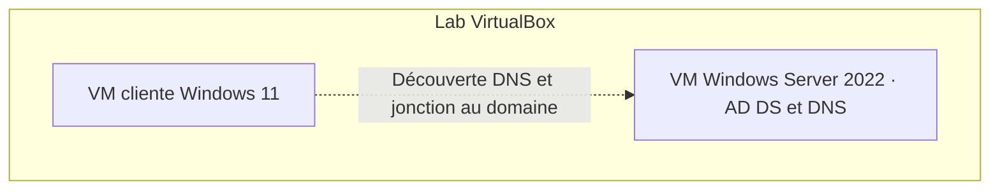

# Architecture du lab

Le schéma représente le lab VirtualBox décrit et les composants identifiés dans les diagnostics AD historiques. Le lien en pointillés indique les vérifications à effectuer sur le client actuel. Le nom de domaine et l’adressage seront documentés après confirmation.

Les contrôles DHCP, GPO et SMB figurent dans la [liste des vérifications AD](../00-On-Premises-Active-Directory/evidence-checklist.md). Le travail sur Microsoft Entra ID est suivi dans le [module d’identité](../01-Microsoft-Entra-ID/README.md). La synchronisation hybride fait partie des [exercices prévus](../08-Hybrid-Identity/README.md).

[Accueil du portfolio](../README.md)
