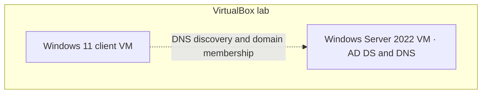

# Lab architecture

The local topology reflects the reported VirtualBox lab and historical AD diagnostics. Dashed edges show relationships to verify on the current client. The domain name and addressing are omitted pending confirmation.

DHCP, GPO and SMB appear in the [AD validation checklist](../00-On-Premises-Active-Directory/evidence-checklist.md). Microsoft Entra ID work is tracked in the [identity module](../01-Microsoft-Entra-ID/README.md). Hybrid synchronization is a [planned exercise](../08-Hybrid-Identity/README.md).

[Portfolio home](../README.md)
